# [**x**{: .orange }hirp.com](/){: .black }
{: .ginormous .wide-block .connect-below .center-if-small }

experienced campaigner.
{: .wide-block .huge .center-if-small .connect-below }

[get in touch](/contact).
{: .left-block .center-if-small }

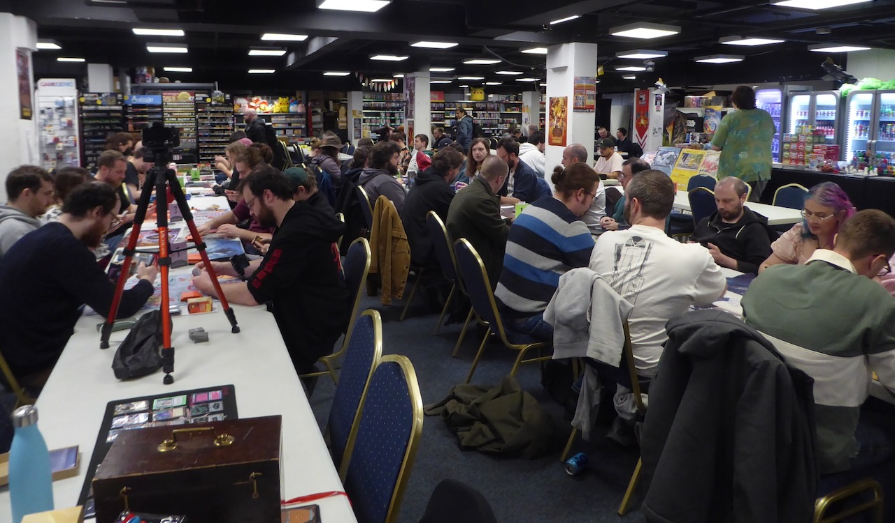
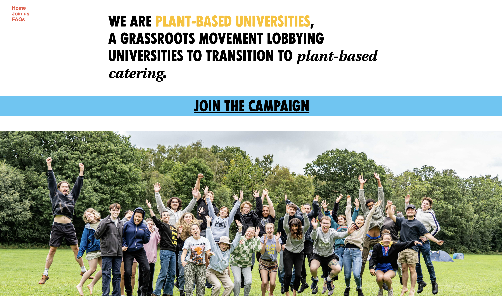{: .size-setter }
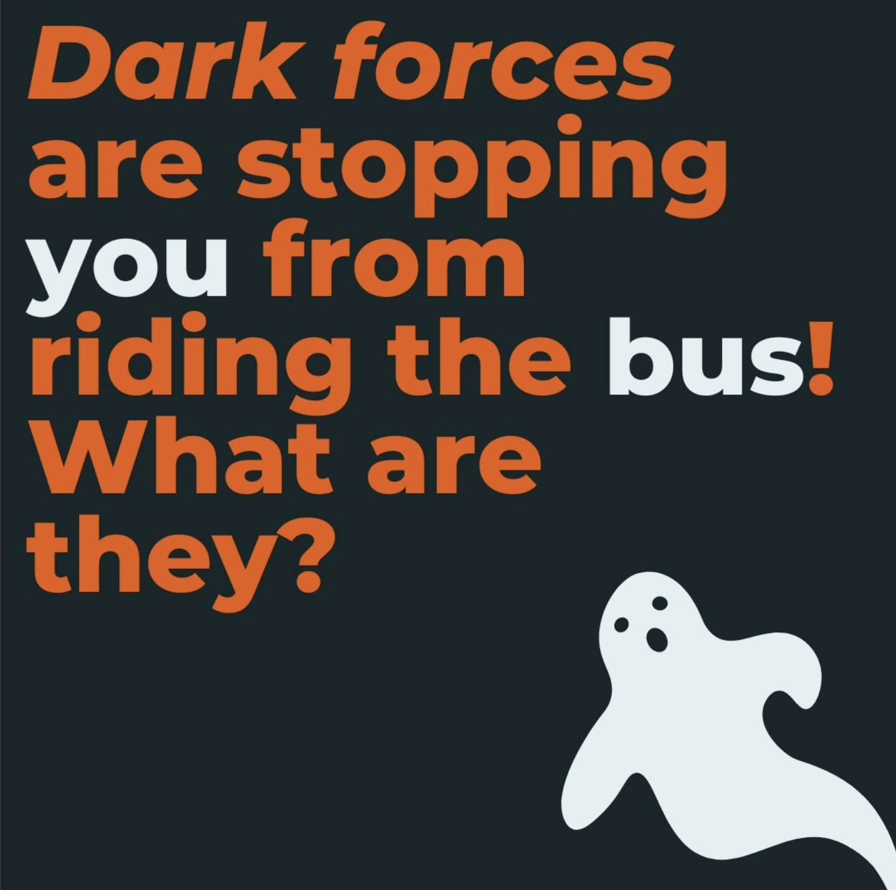
{: .gallery .connect-below }

**writing** & **organising** & **events** & **comms** & **web**
{: .wide-block .center }

For the last four years, I've been immersed in a world of campaigning and activism: I've done research and written web copy; I've coordinated volunteers throughout campaigns and for events; I've created and edited video and text social media posts; and I've built websites for campaigns. I have experience primarily with campaigns about the Planetary Crises.
{: .left-block .small }

## organising & events
{: .middle-block .center-if-small .orange-hover }

**Vice-Chair, Felix**  
Coordinating and helping volunteer writers and editors for Felix, Imperial's student newspaper, including: onboarding new writers, brainstorming ideas, helping writers with their first aritcle, and organising joint research efforts with minutes and clearly assigned tasks.  
*30 articles published by volunteer writers in my section*{: .orange }
{: .middle-block .small }

**Campaign Officer, Winchester Action on the Climate Crisis**  
Helping coordinate volunteers for WinACC's campaign [South Downs for Nature](https://www.winacc.org.uk/south-downs-4-nature/), opposing an oil well opening in the South Downs. Tracking contact with representatives, disussing campaign strategy with volunteers, and contacting and onboarding campaigners.  
*95 representatives contacted by local volunteers*{: .orange }  
{: .middle-block .small }

**Founder, The Cube Collective**  
Planning, organising, and running [cubeCUBE](https://cubecube.xhirp.com), a charity Magic: the Gathering event. Organising the finances and event space, coordinating prize donations, managing cube submissions from volunteers, and running the event on the day. Also, commissioning artwork for and organising the production of playmats and pins.  
*Raised £600+ for Give Directly*{: .orange }
{: .middle-block .small }

**Core Member, Plant-Based Universities Imperial**  
Planning an open forum on our motion about plant-based catering. Structuring the [workshop](https://pbu-imperial.org/assets/pdfs/PBU%20Sust%20forum%20Jan25.pdf) in the style of a citizens assembly, coordinating sections from other volunteers, and meeting with stakeholders in advance to discuss possible concerns.  
*Our motion passed with a supermajority*{: .orange }
{: .middle-block .small }

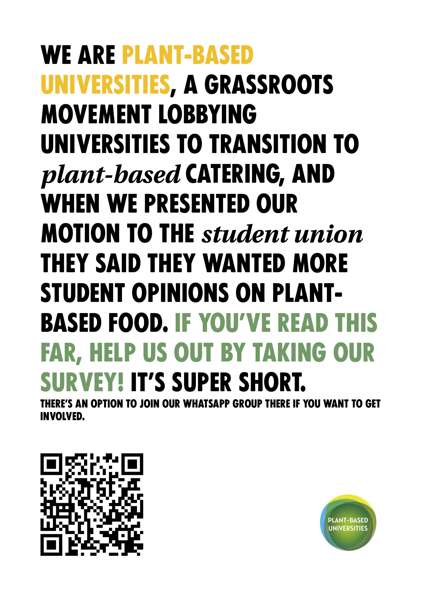
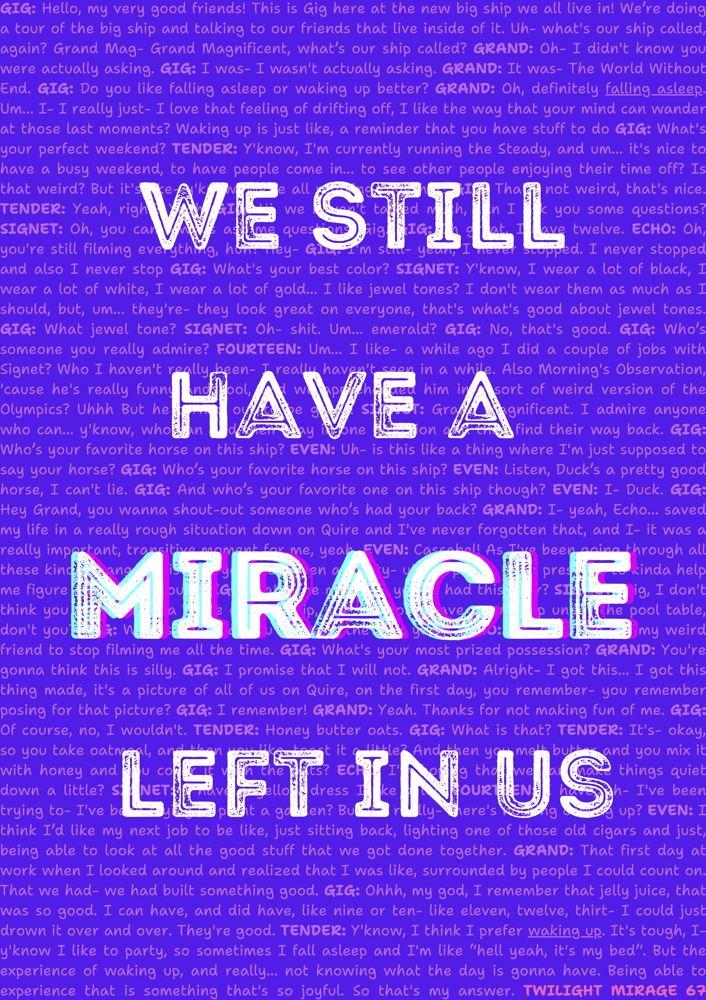{: .size-setter }
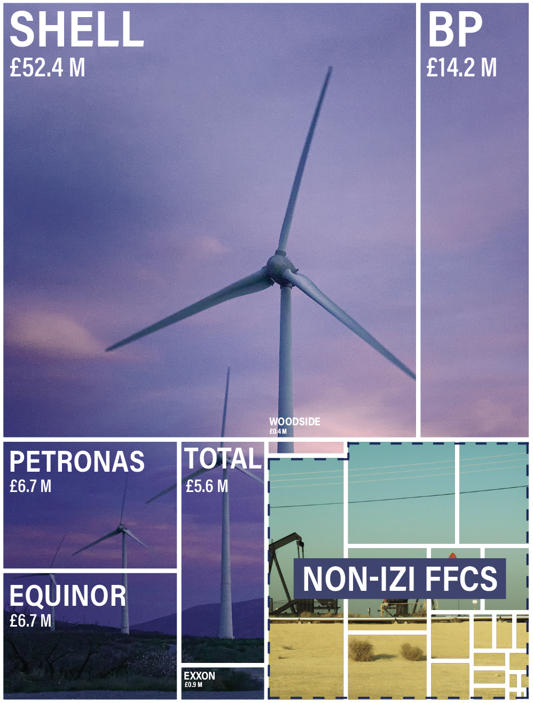
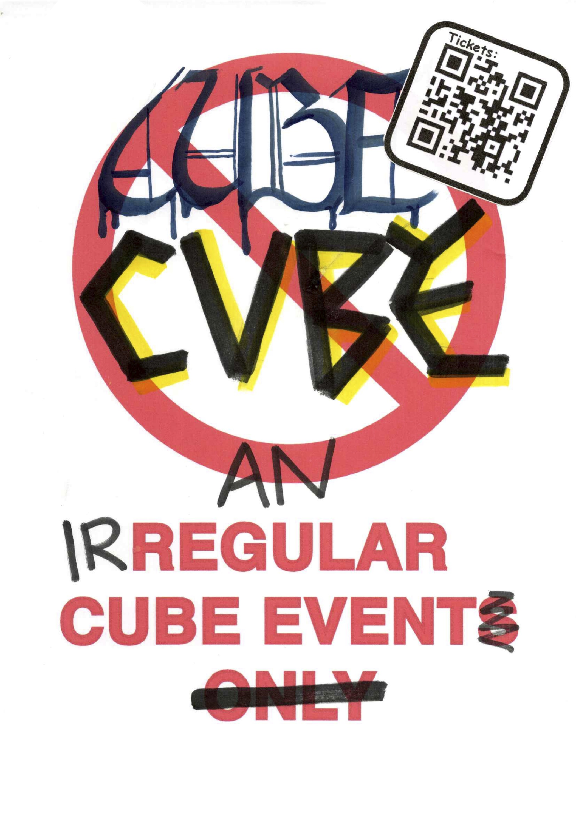
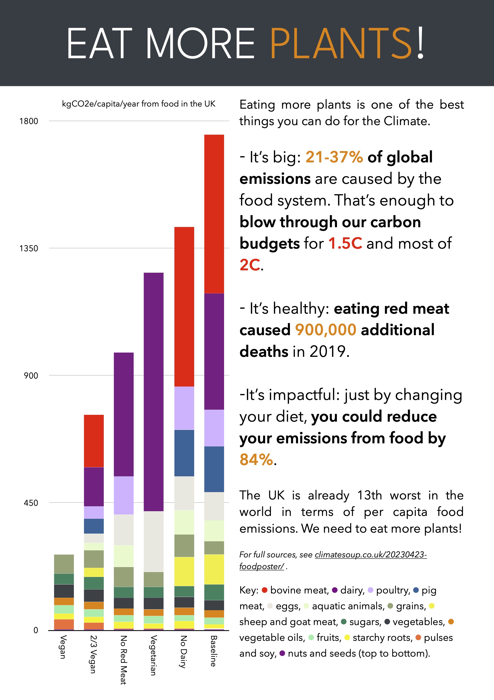
{: .gallery }

## web & social media
{: .middle-block .center-if-small .orange-hover }

**Freelance Web Developer**  
Web development and design for various personal projects and freelance. Building sites primarily using pure HTML/CSS/JS, React, or Jekyll, picking up new tools where needed. Building prototypes and discussing designs with clients.  
*Built 20+ websites for commissions and hobbies*{: .orange }
{: .middle-block .small }

**Core Member, Plant-Based Universities Imperial**  
Building the website for [Plant-Based Universities Imperial](https://pbu-imperial.org) and teaching other members how to use and edit the site. Also, building the website for Imperial Climate Action.  
*Non-technical activists can make changes*{: .orange }
{: .middle-block .small }

**Founder, The Cube Collective**  
Publicity for [cubeCUBE](https://cubecube.xhirp.com), a charity event. Poster and logo design and copywriting for social media posts and posts in WhatsApp groups. Speaking to community leaders about publicising our event.  
*Sold out of tickets twice*{: .orange }
{: .middle-block .small }

**Freelance, Winchester Green Week**  
Social media campaign for [Winchester Green Week 2024](https://www.instagram.com/winchestergreenweek/), including text and video posts leading up to and during the event building excitement and announcing specific upcoming events.  
*Better informing the community about events*{: .orange }
{: .middle-block .small }

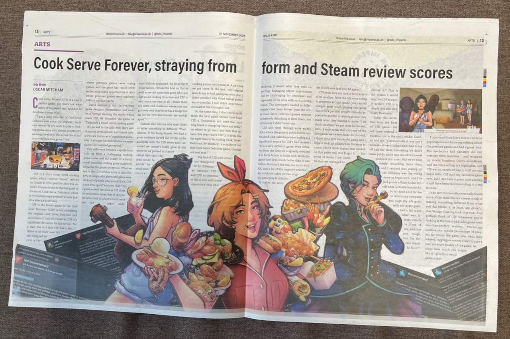
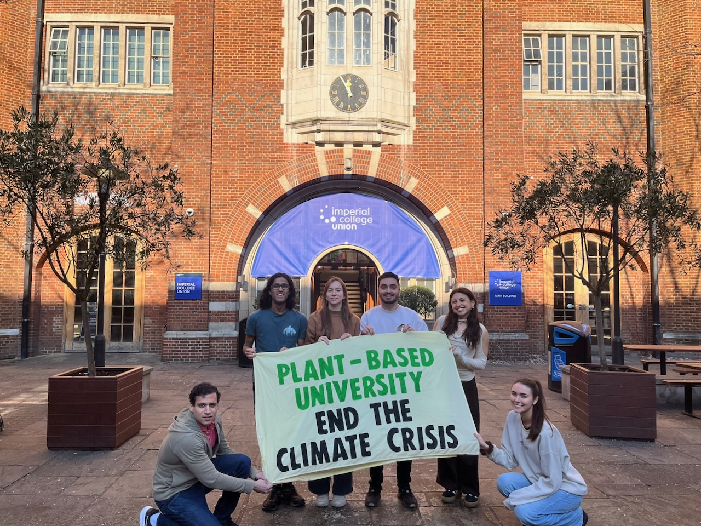{: .size-setter }
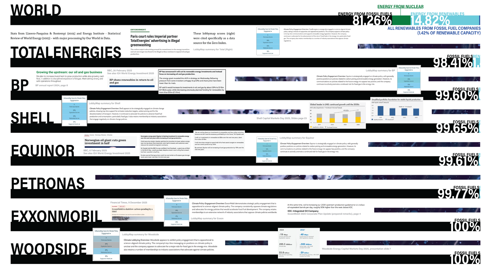
{: .gallery}

## research & writing
{: .middle-block .center-if-small .orange-hover }

**Researcher, Solid Sustainability**  
Researching ties between academia and the fossil fuel industry using a web spider, freedom of information requests, and interviews to build a database of 300+ ties.  
*Contributed to the evidence-base for a study on FFI ties*{: .orange }
{: .middle-block .small }

**Environment Editor, Felix**  
Researching and writing 40+ articles including interviews, investigations, news, and editorials for Imperial's student newspaper, [Felix](https://felixonline.co.uk/author/oscar-mitcham/). Also, editing and fact checking every article for the section while editor.  
*Greater transparency and student awareness*{: .orange }
{: .middle-block .small }

**Researcher, Imperial College London**  
Self-proposed research project building a data pipeline to understand and analyse the energy use of the 300 computers in the Computing teaching labs at Imperial.  
*A public dashboard showing data & the basis of my dissertation*{: .orange }
{: .middle-block .small }

 

---

 

I have a broad set of skills!  
[get in touch](/contact).
{: .left-block .center-if-small}
