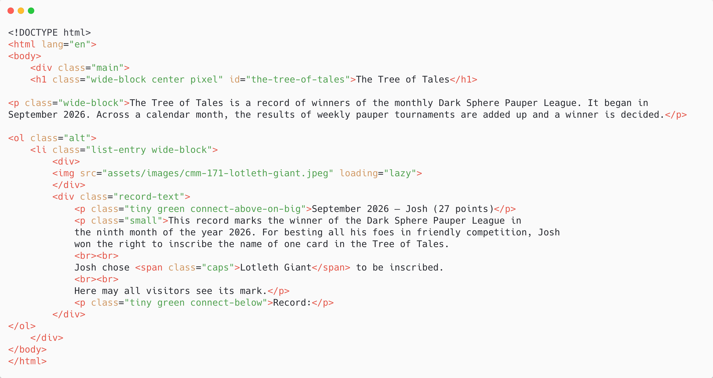
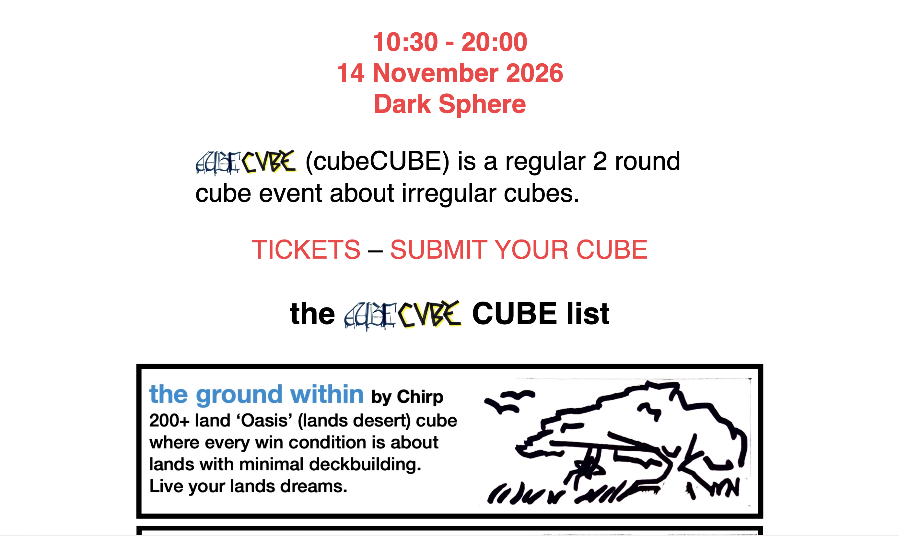
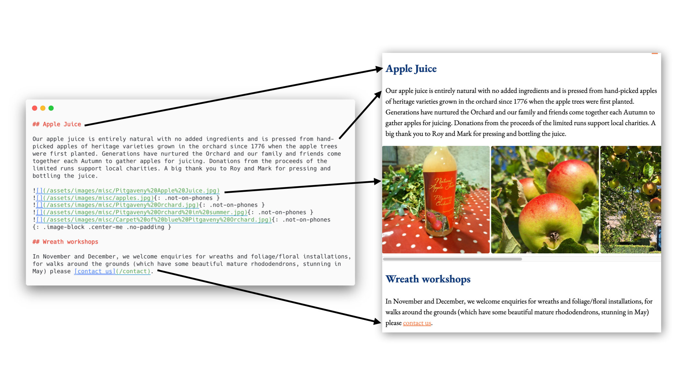
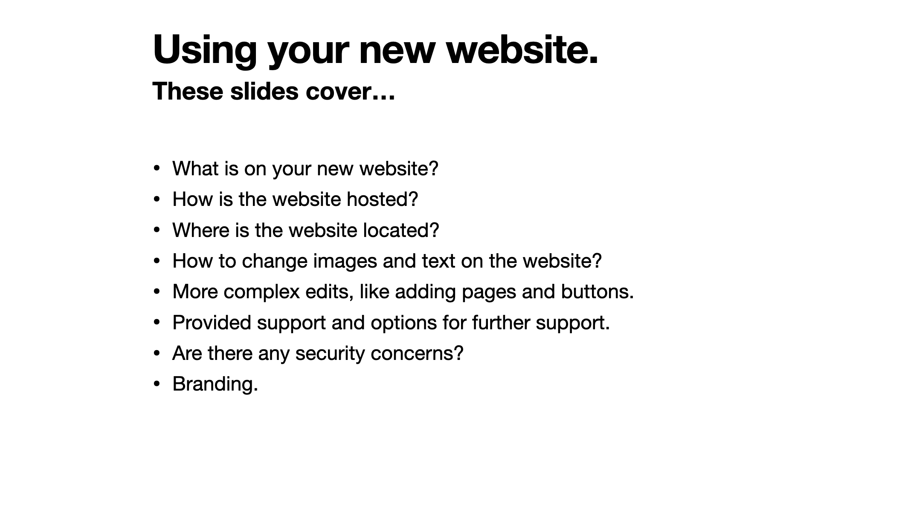

---
# Feel free to add content and custom Front Matter to this file.
# To modify the layout, see https://jekyllrb.com/docs/themes/#overriding-theme-defaults

layout: home
---
# [**x**{: .orange }hirp.com](/){: .black }
{: .ginormous .wide-block .connect-below .center-if-small }

freelance web development  
and design.
{: .wide-block .huge .center-if-small .connect-below }

[get in touch](/contact).
{: .left-block .center-if-small}

{: .wide-image-block }

{: .wide-image-block }

{: .wide-image-block }

opinionated about  
how the web should work and  
how the web should look.
{: .middle-block .center-if-small }

---

Say goodbye to one million spans and meaningless divs. Say hello to HTML that *means something*.
{: .wide-block }

{: .wide-image-block }

---

Put information where people want it. Sensible layouts with no bloat.
{: .wide-block }

{: .wide-image-block }

---

No secret knowledge or technology. Change anything on your website because it's all just *there*.
{: .wide-block }

{: .wide-image-block }

---

Free support for you and your business. I'm not going to keep charging you for maintenance and bug fixes.
{: .wide-block }

{: .wide-image-block }

---

**“**Oscar designed and set up a beautiful website for our Fine Art business. The process was fast, efficient, reasonably priced, and didn’t require any previous knowledge on our part. We took advantage of their technical expertise. All alterations were done quickly and we are now able to update content ourselves. As a small business, we’ve found it invaluable to have a credible, clear and cohesive source of reference for new and existing customers.**”**
{: .wide-block .white .fill-black }

[get in touch](/contact).
{: .left-block .center-if-small}