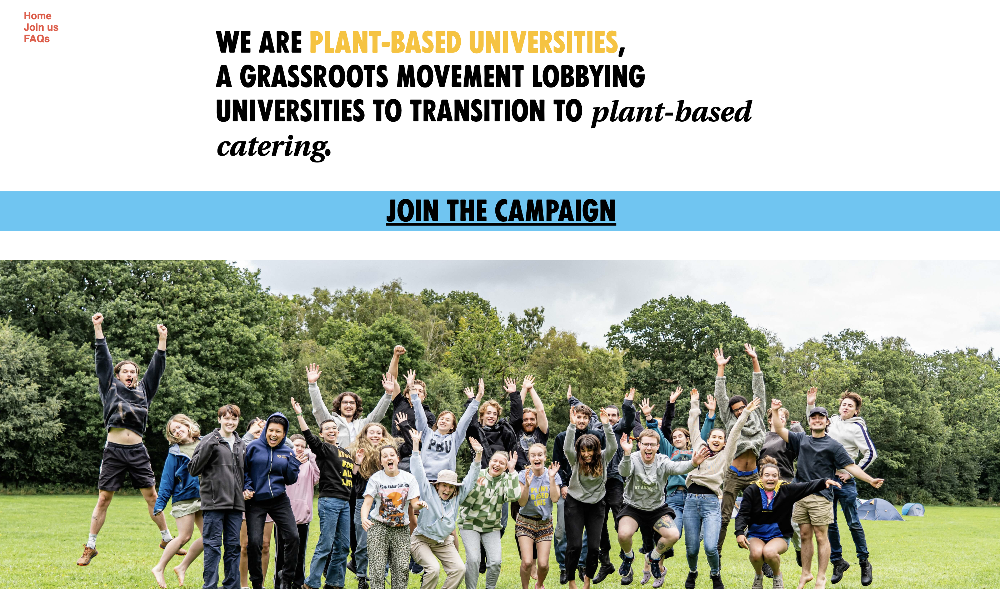
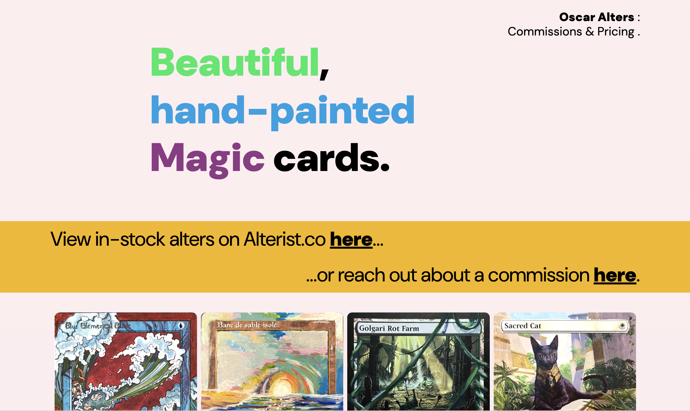
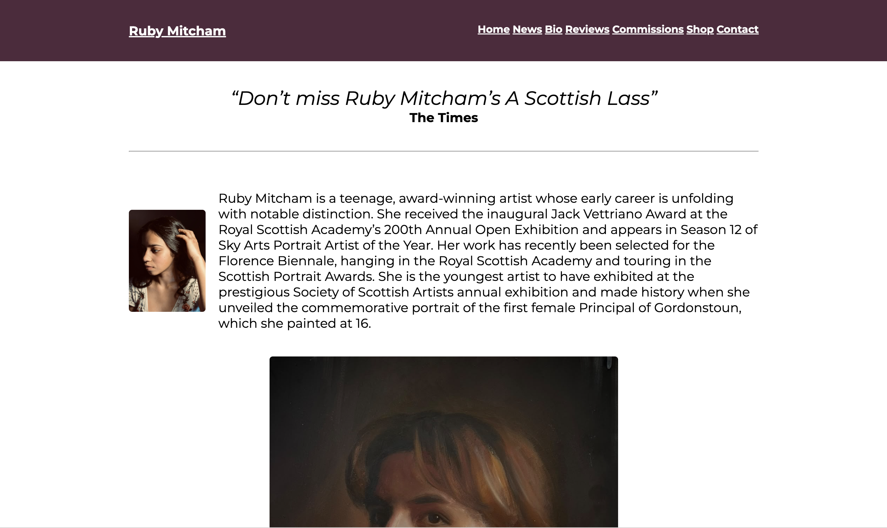
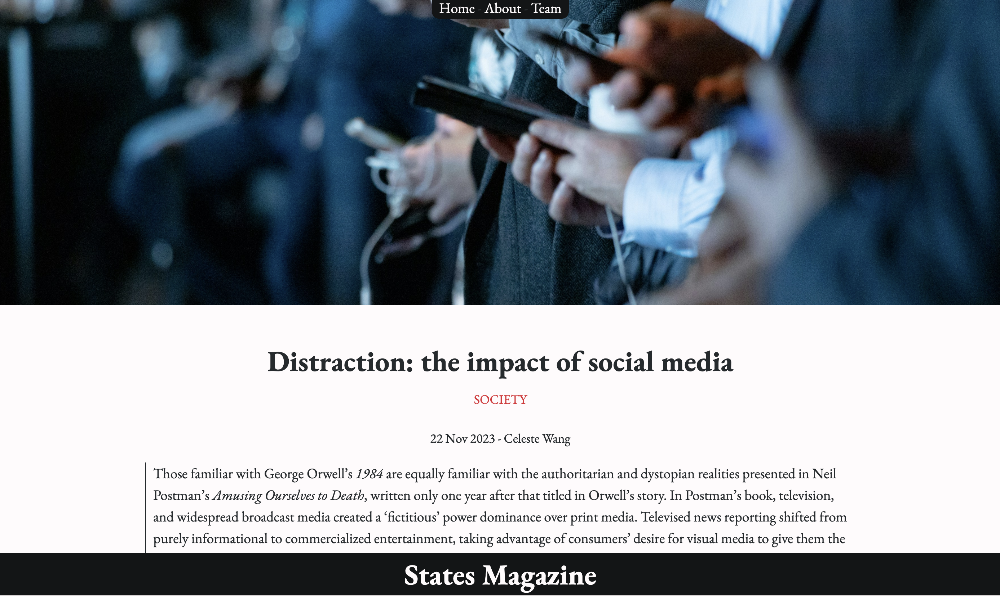

# [**x**{: .orange }hirp.com](/){: .black }
{: .ginormous .wide-block .connect-below .center-if-small }

what are you looking for?
{: .wide-block .huge .center-if-small .connect-below }

[campaigns](/c) – [web dev](/d) – [art](https://art.xhirp.com)
{: .wide-block .center}

[get in touch](/contact).
{: .wide-block .center}

---

## [Campaigns](/c)
{: .left-block }

For the last four years, I’ve been immersed in a world of campaigning and activism. I’ve done everything from research, through coordinating volunteers, to creating websites and social media campaigns.
{: .left-block }

{: .size-setter }

{: .gallery }

## [Web development](/d)
{: .left-block }

I have more than five years of experience building fast, clear, and eco-friendly websites for personal projects and for my clients.
{: .left-block }

{: .size-setter }

{: .gallery }

## [Art](https://art.xhirp.com)
{: .left-block }

Professional freelance arist altering (painting) original artworks and extension of trading cards.
{: .left-block }

{: .size-setter }

{: .gallery .mtg-cards }
