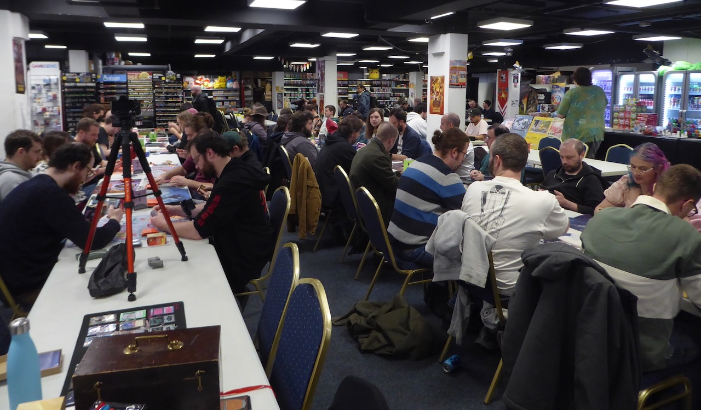
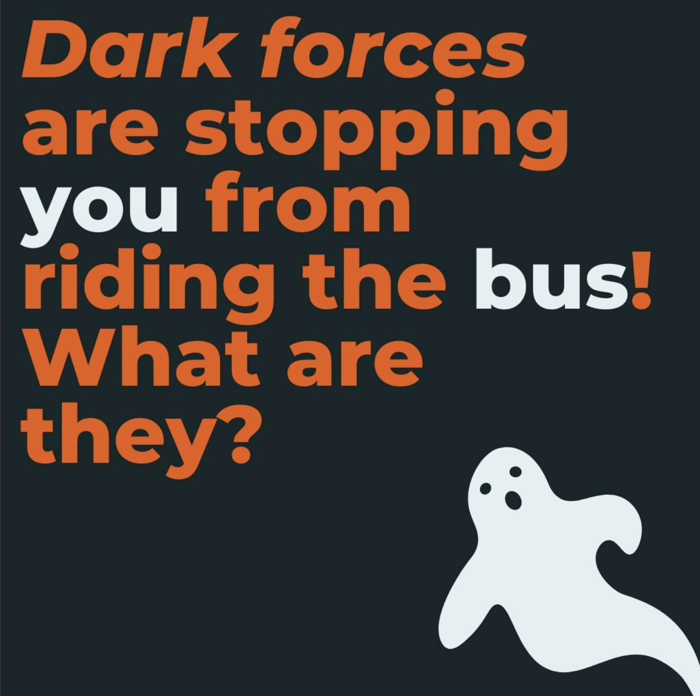

---
# Feel free to add content and custom Front Matter to this file.
# To modify the layout, see https://jekyllrb.com/docs/themes/#overriding-theme-defaults

layout: home
---
# [**x**{: .orange }hirp.com](/){: .black }
{: .ginormous .wide-block .connect-below .center-if-small }

experienced campaigner.
{: .wide-block .huge .center-if-small .connect-below }

[get in touch](/contact).
{: .left-block .center-if-small }

{: .gallery .connect-below }

**writing** & **organising** & **events** & **comms** & **web**
{: .wide-block .center }

For the last four years, I've been immersed in a world of campaigning and activism: I've done research and written web copy; I've coordinated volunteers throughout campaigns and for events; I've created and edited video and text social media posts; and I've built websites for campaigns.
{: .left-block .small }

## research & writing
{: .middle-block .center-if-small }

## organising
{: .middle-block .center-if-small }

## events
{: .middle-block .center-if-small }

## social media
{: .middle-block .center-if-small }

## web design
{: .middle-block .center-if-small }

## merchandise
{: .middle-block .center-if-small }

---

[get in touch](/contact).
{: .left-block .center-if-small}

this is my campaigns portfolio. see also my [art]() and [web design](/design) portfolios.
{: .left-block .small }